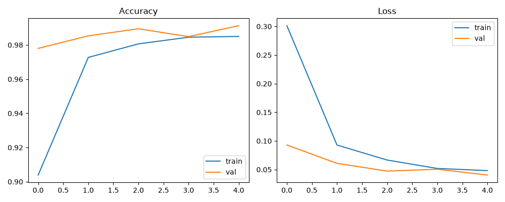
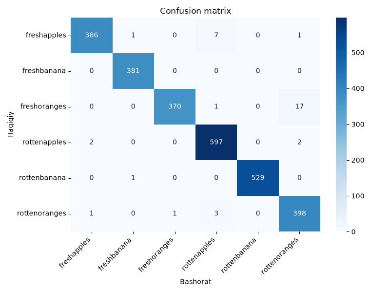

# Fruit Classification and Quality Detection Using Computer Vision

A deep learning project that looks at a photo of a fruit and tells **what the fruit is** (apple, banana, orange) and **whether it is fresh or rotten**.

**Live demo:** https://fruit-quality-detection-xfutti8evehpkwefnkbc5o.streamlit.app/

## Results

| Metric | Value |
|--------|-------|
| Validation accuracy | 99.13% |
| **Test accuracy** | **98.63%** (2,661 of 2,698 unseen images) |

| Class | Precision | Recall | F1-score |
|-------|-----------|--------|----------|
| freshapples | 0.992 | 0.977 | 0.985 |
| freshbanana | 0.995 | 1.000 | 0.997 |
| freshoranges | 0.997 | 0.954 | 0.975 |
| rottenapples | 0.982 | 0.993 | 0.988 |
| rottenbanana | 1.000 | 0.998 | 0.999 |
| rottenoranges | 0.952 | 0.988 | 0.970 |

## How it works

- **Dataset:** [Fruits fresh and rotten for classification](https://www.kaggle.com/datasets/sriramr/fruits-fresh-and-rotten-for-classification) (Kaggle): 6 classes, 10,901 training and 2,698 test images.
- **Model:** MobileNetV2 pre-trained on ImageNet (frozen) + global average pooling + dropout + softmax layer (transfer learning).
- **Augmentation:** random flip, rotation and zoom.
- **Training:** 5 epochs on a laptop CPU (about 15 minutes), Adam optimizer, categorical cross-entropy.
- **Demo app:** Streamlit web app (upload or photograph a fruit, get type, quality and confidence).

## Project structure

    app.py               Streamlit demo app
    train_model.py       Model training
    evaluate_model.py    Test-set evaluation, confusion matrix
    explore_data.py      Dataset inspection
    fruit_model.keras    Trained model
    class_names.json     Class labels
    requirements.txt     Dependencies

## Run locally

    python -m venv venv
    venv\Scripts\activate
    pip install -r requirements.txt
    streamlit run app.py

To retrain, download the dataset from Kaggle, extract it into a data/ folder, then run: python train_model.py

## Limitations and future work

- Only 3 fruit types.
- Dataset images have fairly clean backgrounds; accuracy on messy real-world photos may be lower.
- Next steps: more fruit types, real-world photos, mobile app.

## Author

XV, IT student, Uzbekistan.
